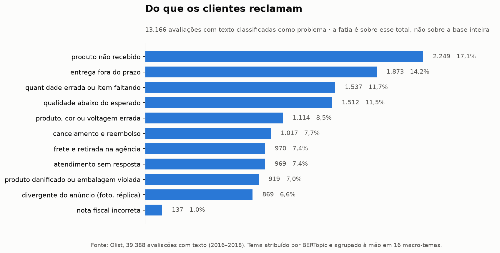
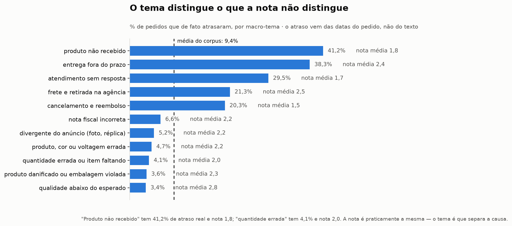

# Voice of Customer Intelligence com RAG

Sistema de perguntas e respostas em linguagem natural sobre as avaliações de
clientes do **Brazilian E-Commerce Public Dataset by Olist**. Gestores perguntam
*"quais os principais problemas relatados nas entregas atrasadas?"* e o sistema
responde fundamentado nas reviews recuperadas, citando quais sustentam cada
afirmação — ou declarando que não há evidência suficiente.

Tech Challenge — Fase 4, Pós-Tech FIAP (AI Scientist).

> **Estado em 15/11/2026:** pipeline completo de ponta a ponta. Corpus de
> **39.388 documentos**, dois índices (FAISS + BM25) com fusão RRF, camada de
> **16 macro-temas** para perguntas de frequência, portão de suficiência
> calibrado e validado fora da amostra, geração local com citação obrigatória
> verificada por código, e a interface de uso em [`app.py`](app.py).
> **91 testes** passando.
>
> **Nenhuma chave de API é necessária.** A geração roda 100% local, e nenhum
> dado sai da máquina. O log completo de decisões — 43 entradas com
> alternativas consideradas, medição e custo assumido em cada uma — está em
> [`docs/contexto/decisoes.md`](docs/contexto/decisoes.md).
>
> 🎥 **Vídeo:** `<link a incluir>` · roteiro em
> [`docs/roteiro-video.md`](docs/roteiro-video.md) (12 slides, linguagem de
> arguição) ou [`docs/roteiro-video-simples.md`](docs/roteiro-video-simples.md)
> (8 slides, linguagem falada — mesmos nove tópicos exigidos).

---

## Resumo executivo

Para quem vai avaliar: cada requisito do enunciado, como foi atendido e onde ler
o detalhe.

| requisito do enunciado | como foi atendido | onde |
|---|---|---|
| **1. Base de conhecimento** — seleção, limpeza, ausentes, organização, embeddings, indexação | 99.224 → 39.388 documentos com funil declarado; **três** rotas de limpeza porque o pipeline canônico apagaria a negação; uma review = um documento | [§3](#3-requisito-1--base-de-conhecimento) |
| **2. Pipeline RAG** — transformação da pergunta, recuperação, seleção, contexto, geração | busca híbrida FAISS + BM25 com RRF k=60, termo obrigatório por IDF, contexto em tags XML numeradas, geração local | [§5](#5-requisito-2--pipeline-rag) |
| **3. Respostas fundamentadas** — mostrar as evidências | `review_id` conferido **por código**: resposta que cita o que não estava no contexto vira abstenção | [§6](#6-requisito-3--respostas-fundamentadas) |
| **4. Limites** — fora do escopo, sem evidência, evidência insuficiente | quatro camadas de abstenção e três graus de suficiência; só uma delas depende do modelo obedecer | [§7](#7-requisito-4--limites-e-abstenção) |
| **Opcional: metadados** | 8 campos viajam com o documento; filtro exato por categoria, UF, mês e atraso na rota de contagem | [§3.6](#36-metadados) |

E os números que sustentam isso:

| | |
|---|---|
| recuperação (recall@5, 12 perguntas com gabarito) | **10/12** |
| portão de suficiência — calibração / validação disjunta | **95% / 100%** |
| fidelidade: invenção mediana nas respostas geradas | **0%** |
| citação falsa possível? | **não** — conferida por comparação de string |
| custo por pergunta | **R$ 0,00** |
| testes | **91** |

**As três coisas que eu defenderia numa banca**, se tivesse de escolher três:

1. **A negação sobrevive.** O pipeline de pré-processamento do curso remove
   stop words, e `não`/`nem`/`sem`/`mas` são stop words. Numa base cujo valor
   está nas reclamações, aplicá-lo ao texto que vira embedding inverteria o
   sentido de 25,9% do corpus. Daí três rotas de limpeza com destinos
   diferentes — [§3.4](#34-limpeza-a-decisão-de-maior-impacto).
2. **"Principais problemas" não é pergunta de RAG.** A busca devolve o mais
   *parecido*, não o mais *frequente*. Responder isso com os 5 documentos do
   top-k parece certo e é metodologicamente errado; existe uma camada de
   contagem separada, com denominador declarado — [§4.2](#42-a-camada-de-temas).
3. **A correção não depende do modelo.** O guardrail compara strings, a
   contagem vem do pandas, o portão vem do cosseno. O LLM só redige a frase
   final. É por isso que um modelo de 0,5B é aceitável: ele escreve pior,
   **não cita falso** — [§9.4](#94-a-restrição-de-hardware-e-por-que-ela-não-afeta-a-correção).

---

## Sumário

1. [O problema de negócio](#1-o-problema-de-negócio)
2. [Instalação, reprodução e uso](#2-instalação-reprodução-e-uso)
3. [Requisito 1 — Base de conhecimento](#3-requisito-1--base-de-conhecimento)
4. [Arquitetura](#4-arquitetura)
5. [Requisito 2 — Pipeline RAG](#5-requisito-2--pipeline-rag)
6. [Requisito 3 — Respostas fundamentadas](#6-requisito-3--respostas-fundamentadas)
7. [Requisito 4 — Limites e abstenção](#7-requisito-4--limites-e-abstenção)
8. [Ética, privacidade e segurança](#8-ética-privacidade-e-segurança)
9. [Avaliação](#9-avaliação)
10. [Estrutura, testes e tecnologias](#10-estrutura-testes-e-tecnologias)
11. [Alinhamento com o material do curso](#11-alinhamento-com-o-material-do-curso)
12. [Limitações conhecidas e próximos passos](#12-limitações-conhecidas-e-próximos-passos)

---

## 1. O problema de negócio

O Olist acumula 99.224 avaliações entre outubro de 2016 e agosto de 2018. A nota
de 1 a 5 diz *o quanto* o cliente ficou insatisfeito; só o texto diz **por quê**.
Esse texto existe em 43,0% das avaliações e nunca foi lido em conjunto — é
volume demais para leitura manual e desestruturado demais para SQL.

A pergunta que o negócio faz não é "qual a nota média da categoria X", que um
`GROUP BY` responde. É "o que os clientes reclamam quando a entrega atrasa" —
uma pergunta sobre conteúdo, que exige recuperar os depoimentos semanticamente
relacionados e sintetizá-los **sem inventar**.

### 1.1 Por que RAG, e não *fine-tuning*

A aula 02 de IA Generativa dá três sinais de que RAG é a arquitetura certa, e
diz que **dois dos três já bastam**. Aqui os três aparecem:

| sinal da aula | neste projeto |
|---|---|
| **conhecimento interno** | as reviews são dado proprietário do Olist. Nenhum modelo pré-treinado sabe o que o cliente escreveu sobre um pedido específico |
| **informação que muda** | chegam avaliações todo dia. Reindexar são minutos; retreinar é outra ordem de grandeza de tempo e custo, e a cada lote novo |
| **resposta auditável** | o gestor precisa ver **quais** reviews sustentam o insight. É o critério de rastreabilidade do enunciado |

O argumento decisivo é o terceiro. *Fine-tuning* dilui o texto nos pesos: o
modelo passa a falar *como* quem leu as reviews, sem conseguir devolver a
review. Um modelo ajustado continuaria sem poder citar `review_id`, e é a
citação que torna a resposta verificável. Ajuste fino ensina **forma**;
recuperação entrega **fato com procedência**.

Dito de outro jeito: se o sistema errasse, com RAG dá para abrir a fonte e ver
onde errou. Com *fine-tuning* não há onde olhar.

---

## 2. Instalação, reprodução e uso

### 2.1 Instalação

Requer Python 3.14 (testado em 3.14.0, Windows).

```bash
git clone https://github.com/luiz-mota/tech-challenge-fase4.git
cd tech-challenge-fase4

python -m venv .venv
.venv/Scripts/activate        # Windows
# source .venv/bin/activate   # Linux/macOS

pip install -r requirements.txt
python -c "import nltk; [nltk.download(p, quiet=True) for p in ['stopwords','rslp','punkt','punkt_tab']]"
```

### 2.2 Reprodução

Na ordem — cada etapa consome a saída da anterior:

```bash
python src/ingestion/download_olist.py          # 1. baixa os 9 CSVs (~43 MB)
python -m src.knowledge_base.preparar_corpus    # 2. corpus.parquet (39.388 docs)
python -m src.retrieval.indices                 # 3. FAISS + BM25   (~8 min, CPU)
python -m src.knowledge_base.temas              # 4. 101 temas      (~7 min, CPU)
python -m src.knowledge_base.mapa_macro         # 5. 16 macro-temas
python -m src.knowledge_base.aplicar_temas      # 6. aplica aos 39.388
pytest tests/ -q                                # 91 testes
```

Para inspecionar camada por camada, ou regerar os artefatos de avaliação:

```bash
python -m src.generation.pipeline               # roteia e responde
python -m src.generation.agregacao              # só a camada de contagem
python -m src.retrieval.busca                   # só a busca híbrida e o portão
python -m src.evaluation.calibrar               # recall@k e calibração do portão
python -m src.evaluation.fidelidade             # ancoragem da resposta na evidência
python -m src.evaluation.figuras                # as duas figuras deste README
```

Os dados não são versionados: são reproduzíveis pelos comandos acima. Os
modelos (~4 GB) baixam do HuggingFace na primeira execução e ficam em cache.

**Reprodutibilidade não é promessa, é propriedade testada.** Duas armadilhas
silenciosas foram encontradas e fechadas: o cache de embeddings não tinha
assinatura e reusava vetor velho depois de o corpus mudar; e `aplicar_temas`
lia o próprio arquivo de saída, o que fazia a segunda execução divergir da
primeira. As duas estão descritas em [§12](#12-limitações-conhecidas-e-próximos-passos).

### 2.3 Como usar

```bash
python app.py                           # modo interativo
python app.py -p "sua pergunta"         # uma pergunta e sai
python app.py -p "..." --fontes         # e imprime as reviews citadas na íntegra
python app.py --demo                    # roteiro de 8 perguntas
python app.py --sem-llm                 # só contagem e série temporal (0,4 s para subir)
```

No modo interativo, linhas que começam com `:` são comandos: `:temas` lista os
16 macro-temas com volume, nota média e taxa de atraso; `:fontes` abre o texto
integral das reviews que a última resposta citou; `:rota <pergunta>` mostra para
onde o roteador manda, sem executar.

**Por que CLI, e não Streamlit.** A máquina de desenvolvimento tem 7,9 GB de RAM
com **0,2 GB livres**, e o processo já carrega o índice FAISS com 39.388
vetores, o BM25 serializado, o corpus em pandas e dois modelos. Streamlit
acrescenta um servidor e um segundo processo Python ao mesmo orçamento — e foi
exatamente a falta de memória que tornou a geração 50× mais lenta na medição do
dia 14. A decisão é de restrição medida, não de preferência.

Há um ganho de avaliação junto: a CLI mostra a **decisão**, não só a resposta.
Cada pergunta imprime a rota escolhida, por qual via o portão de suficiência
passou e o motivo da abstenção quando ela acontece. Uma caixa de chat esconde
isso.

### 2.4 Exemplos de pergunta e resposta

Pergunta de evidência, com as fontes abertas:

```
ROTA: evidencia [macro=produto_danificado] — nenhum padrão de contagem — vai
      para o RAG, que tem o portão de suficiência atrás
PERGUNTA: "o que dizem os clientes sobre a caixa amassada?"
  Os clientes relatam que a caixa veio toda amassada e foi entregue de forma
  inadequada.
  citou 5: 2e4bd919, b46f1e34, b46e9ea6, fb1bbcb5, 43d38fca
  RESSALVA de evidência fraca: a base trata do assunto, mas poucos
  depoimentos sustentam esta resposta.
  22773 ms

  [b46e9ea6] 15/08/2018 · nota 4 · construcao_ferramentas · SP · no prazo
      recomendo. chegou, obrigada mas a caixa, a embalagem amassada e é um
      presente.

  [fb1bbcb5] 02/02/2018 · nota 3 · eletronicos · RJ · no prazo
      O produto chegou com a caixa toda amassada! Muito amassada mesmo.
      nenhum cuidado com o produto!

  [2e4bd919] 01/08/2018 · nota 1 · brinquedos · PI · no prazo
      Ruim. O produto chegou com a caixa amassada
```

Repare no que a ressalva está dizendo: das cinco reviews recuperadas, duas são
nota 4 e 5 e falam da caixa **sem** o produto ter sido danificado. A evidência
existe e é fraca — e o sistema diz isso em vez de afirmar no mesmo tom de
quando há folga.

Pergunta fora do corpus — a abstenção vem com a causa, e em 649 ms, porque o
portão barra **antes** de chamar o modelo:

```
PERGUNTA: "qual a política de troca e devolução da Olist?"
  ABSTEVE (portao): Não encontrei essa informação nas avaliações da base.
  por que absteve: a busca não encontrou base suficiente no corpus
```

Pergunta que identifica uma pessoa — barrada na entrada, antes de qualquer
busca, em 0 ms:

```
PERGUNTA: "quais os principais problemas do cliente CPF 529.982.247-25?"
  BLOQUEADA na entrada: a pergunta contém dado pessoal (cpf). Este assistente
  responde sobre padrões e depoimentos do conjunto de avaliações, não sobre
  clientes identificados.
```

Pergunta de frequência — não passa pelo LLM, e o denominador vai junto:

```
ROTA: frequencia — padrão de frequência '\bprincipais?\b'
PERGUNTA: "quais os principais problemas relatados pelos clientes?"

O problema mais relatado é **produto não recebido**, com 2.249 relatos (17,1%
das 13.166 avaliações com problema identificado). Somando os temas de entrega,
são 4.122 relatos (31,3%). Ficam fora desta contagem 4.539 avaliações (11,5%
do corpus) que tratam de vários assuntos ao mesmo tempo, não têm padrão
recorrente ou ainda não foram avaliadas.

  tema                                        relatos      %   nota  atraso
  -------------------------------------------------------------------------
  produto não recebido                          2.249  17,1%   1,76   41,2%
  entrega fora do prazo                         1.873  14,2%   2,42   38,3%
  quantidade errada ou item faltando            1.537  11,7%   1,97    4,1%
  qualidade abaixo do esperado                  1.512  11,5%   2,82    3,4%
  produto, cor ou voltagem errada               1.114   8,5%   2,17    4,7%
  cancelamento e reembolso                      1.017   7,7%   1,53   20,3%

  base: 13.166 avaliações com problema identificado
  Estes números descrevem quem escreveu avaliação, não quem comprou. Escrevem
  sobretudo clientes nos extremos: 77,3% das avaliações nota 1 têm texto,
  contra 32,8% das nota 4.
  evidências: 8e203b9e, 7dc116ac, 297292ce, c9fbd2ab, 653a1d4e, 598c3606, …

  tempo total: 101 ms
```

Três coisas nessa saída não são enfeite: o **denominador** (13.166, não
99.224), o **aviso de viés**, e os `review_id` de exemplo — a resposta de
contagem também é auditável até o depoimento. E ela sai em 101 ms, porque não
passa pelo LLM.

---

## 3. Requisito 1 — Base de conhecimento

### 3.1 Seleção dos dados

A base do Olist tem nove tabelas. A tabela `olist_order_reviews_dataset` é a
única que contém texto escrito por clientes e por isso é a única fonte de
documentos. As demais entram apenas como **metadados** de filtro
([§3.6](#36-metadados)), nunca como conteúdo indexado — descrições de produto e
nomes de categoria não são voz do cliente, e misturá-las ao índice faria o
sistema recuperar catálogo quando o gestor pergunta por reclamação.

### 3.2 Tratamento de valores ausentes

| campo | ausentes | decisão |
|---|---:|---|
| `review_comment_message` | 58.274 (58,7%) | não descarta: o título pode ter o texto |
| `review_comment_title` | 87.658 (88,3%) | concatenado quando existe |
| **ambos ausentes** | **56.537 (57,0%)** | **documento não é criado** |
| `review_score` | 0 | — |
| `atraso_dias` (derivado) | 4,7% do corpus | metadado fica nulo |

**Ausência de texto não é valor faltante a imputar.** Não existe imputação
honesta para uma opinião que o cliente não escreveu: preencher com a nota, com a
média da categoria ou com string vazia produziria um vetor sem significado, que
o retrieval devolveria como se fosse depoimento. As 56.537 avaliações sem
nenhum dos dois campos permanecem disponíveis como **denominador estatístico**,
fora do índice.

**O critério de inclusão é ter texto, não ter texto num campo específico.** O
formulário do Olist tem dois campos e o cliente usa o que quer:

| situação | reviews |
|---|---:|
| título **e** mensagem | 9.829 |
| **só** mensagem | 31.121 |
| **só** título | 1.737 |
| nenhum dos dois | 56.537 |

Em **1.737 avaliações o título é o único texto escrito**, e 85 delas têm nota 1 —
*"Não recebi o produto."* está entre elas. Exigir `review_comment_message`
descartaria essas reviews por causa de **onde** a pessoa digitou, não do que ela
escreveu. Os dois campos são a mesma opinião fragmentada pelo formulário, então
são concatenados (`"{título}. {mensagem}"`) em vez de virarem campos separados.

**Uma ausência que o metadado esconde.** `entrega_atrasada` é booleano e vale
`False` quando não existe data de entrega — 1.834 documentos (4,7%), dos quais
619 apenas despachados, 408 indisponíveis e 381 cancelados. Um pedido cancelado
não foi "entregue no prazo"; ele não foi entregue. O efeito é **deflacionar**
levemente a taxa de atraso, nunca inflá-la, e por isso foi aceito — mas fica
declarado, porque é exatamente o tipo de nulo que vira número errado quando
ninguém olha.

### 3.3 O viés do corpus textual — restrição de projeto

Quem está insatisfeito escreve mais:

| nota | avaliações | escreveram texto | % |
|---:|---:|---:|---:|
| 1 | 11.424 | 8.829 | **77,3%** |
| 2 | 3.151 | 2.165 | 68,7% |
| 3 | 8.179 | 3.643 | 44,5% |
| 4 | 19.142 | 6.274 | 32,8% |
| 5 | 57.328 | 21.776 | 38,0% |

Nota 1 representa 11,5% da base completa e **21,9% do corpus indexado** — quase o
dobro. Toda contagem feita sobre os documentos recuperados descreve, portanto,
*quem escreveu*, não *quem comprou*.

Isso não é corrigível por amostragem — reponderar destruiria a cobertura
temática. É tratado como **restrição explícita**: o sistema responde sobre
*temas relatados* e nunca sobre *proporção de clientes*, a instrução consta do
prompt de geração, e o aviso sai junto de toda resposta de contagem.

### 3.4 Limpeza: a decisão de maior impacto

O material do curso fornece um pipeline canônico de pré-processamento — limpeza,
remoção de stop words e stemização RSLP. Aplicá-lo ao texto que vira embedding
**inverteria o sentido do corpus**:

```
'Não gostei, veio quebrado e atrasado.'  ->  ['gost', 'vei', 'quebr', 'atras']
```

`não`, `nem`, `sem` e `mas` estão entre as 207 stop words do NLTK em português.
Após a remoção, *"Não chegou o produto"* e *"Chegou o produto"* produzem vetores
idênticos. **25,9% do corpus contém marcador de negação** — numa base cujo valor
está nas reclamações, esse pré-processamento é destrutivo.

O mesmo vale para o filtro de caracteres, que descarta dígitos:

```
ANTES : Comprei o produto dia 25 de fevereiro e hoje dia 29 de março não fora entregue
DEPOIS: comprei o produto dia de fevereiro e hoje dia de março não fora entregue
```

O atraso de 33 dias — o conteúdo inteiro da reclamação — desaparece. **10,05%
das reviews contêm dígito.**

A causa é conceitual, não um defeito do material: BoW e TF-IDF representam
**frequência**, e ali `não` é de fato ruído de alta frequência. Embeddings densos
representam **sentido**, e tudo que se apaga antes de gerá-los é uma declaração
de que aquilo não altera a distância entre dois textos. São objetivos opostos.

O projeto mantém rotas separadas, com destinos distintos
([`src/knowledge_base/limpeza.py`](src/knowledge_base/limpeza.py)):

| | `normalizar_para_indexacao()` | `pipeline_lexical_bm25()` | `pipeline_nlp_analitico()` |
|---|---|---|---|
| destino | texto vetorizado (FAISS) | perna BM25 | análise, BoW/TF-IDF, tópicos |
| stop words comuns | preserva | remove | remove |
| negação | **preserva** | **preserva** | remove |
| stemização | não | RSLP, exceto na negação | RSLP em tudo |
| dígitos / acento / caixa / emoji | preserva | descarta | descarta |
| representa | **sentido** | **palavra** | **frequência** |

A distinção é a razão de existir das três rotas: o embedding representa
**sentido**, o BM25 compara **palavra**, e só a análise representa **frequência**
— que é o único uso em que `não` é legitimamente ruído de alta frequência.

Três ajustes foram necessários, todos medidos nas 207 stop words do NLTK:

1. `não`, `nem`, `sem` e `mas` **são** stop words, e saem do conjunto removido;
2. `nunca`, `jamais`, `nada` e `nenhum` **não** são stop words e sobreviveriam,
   mas o RSLP os deforma (`nunca`→`nunc`, `jamais`→`jamal`); a negação não é
   stemizada para o token do índice casar com o da consulta;
3. `não` é stop word e `nao` **sem acento não é** — o cliente escreve das duas
   formas, e o índice ficaria com uma e sem a outra. As variantes são canonizadas
   antes do filtro.

**O que `normalizar_para_indexacao()` remove**, medido nos 39.388 documentos —
apenas ruído de superfície:

| operação | reviews afetadas |
|---|---:|
| normalização Unicode NFC | — (acentos decompostos quebram a tokenização) |
| remoção de HTML | 0 |
| remoção de URL / e-mail | 3 |
| expansão de contrações (`pra`, `pq`, `n`, `vc`…) | 1.386 (3,52%) |
| colapso de pontuação repetida (`!!!!` → `!`) | 4.366 (11,08%) |

**O que preserva, e por quê:**

- **caixa** — 3,00% das reviews são inteiramente em maiúsculas; é ênfase, não ruído;
- **acentos** — 57,99% têm acento. O downstream é um tokenizer treinado em
  português: `coração` está no vocabulário, `coracao` fragmenta em subwords.
  A pergunta do material ("remover acentos?") é sensível ao downstream, e para
  retrieval denso a resposta é não;
- **dígitos** — 11,25%, e é neles que mora a evidência quantitativa;
- **emoji** — 0,70%, carregam polaridade;
- **negação** — 27,31%, pelo motivo acima.

### 3.5 Organização dos documentos

```
99.224  avaliações no arquivo bruto
42.687  com texto em título OU mensagem     −56.537
42.370  após dedupe por review_id              −317
39.388  com >= 2 palavras após normalizar   −2.982
```

**Dedupe por `review_id`.** O campo não é chave: 307 ids aparecem em 624 linhas,
com mesmo texto e mesma nota, ligados a `order_id` diferentes. Sem dedupe, o
mesmo depoimento é recuperado duas vezes e o LLM o lê como duas evidências
independentes — evidência inflada por artefato da base.

**Piso de 2 palavras.** O corte é parâmetro (`MIN_PALAVRAS`) e existe porque
texto de uma palavra solta (`"bom"`, `"ok"`, `"5"`) não sustenta insight e
compete por vaga no top-k da recuperação.

O piso foi **4 até 12/11/2026**, e a correção merece registro porque o erro é
instrutivo. O 4 havia sido calibrado comparando com 6 — "4 é melhor que 6, que
cortaria *chegou quebrado*" — e ninguém comparou com 2. Mas *"chegou quebrado"*
tem duas palavras: o piso de 4 cortava justamente o exemplo usado para
defendê-lo. A medição mostrou o tamanho do problema:

| palavras | descartadas | com negação |
|---:|---:|---:|
| 1 | 2.020 | 5 |
| 2 | 2.725 | 89 |
| 3 | 2.084 | 129 |

A nota média dos descartados **com** negação era 2,28, contra 4,50 dos
descartados **sem** negação — o corte era enviesado contra a reclamação, e levava
*"Não chegou"*, *"Não foi entregue"*, *"Produto nunca chegou"*, *"Ainda não
recebi"*: exatamente o tipo de pergunta que o desafio faz.

O argumento decisivo foi outro, porém: **incluir é reversível, excluir não é.**
Com a coluna `n_palavras` preservada, a camada de recuperação pode despriorizar
texto curto depois; recuperar o que ficou fora exige reconstruir o corpus.

**Custo assumido.** Entram 4.809 reviews, das quais só ~218 têm negação; as
demais são elogio curto sem conteúdo. A redundância de texto do corpus sobe de
2,3% para 7,7% (`"muito bom"` aparece 352 vezes), e documento curto pontua alto
no BM25 por normalização de comprimento. A mitigação é colapsar textos idênticos
**na apresentação**, não na ingestão: *"não recebi o produto"* repetido 53 vezes
são 53 clientes com o mesmo problema — corroboração, não duplicata. Para a
modelagem de tópicos, que produz lixo sobre `"muito bom"`, o piso aplicado é
maior (6) que o do índice.

**Um documento por review, sem chunking.** O campo é truncado em 208 caracteres
na origem: a maior review do corpus tem 49 palavras, mediana de 10. Nenhuma
chega perto do limite de qualquer modelo de embedding, e fragmentar separaria o
problema da sua justificativa dentro da mesma frase.

**Corpus final: 39.388 documentos**, mediana de 10 palavras, p90 de 29, máximo
de 49. Dos 1.737 recuperados pelo título, 767 sobreviveram ao piso — o resto era
`"Ótimo"`, `"bom"`, `"5"`, de uma palavra só, e o piso filtrou o ruído sozinho.

### 3.6 Metadados

Todos os 39.388 documentos casam com `olist_orders_dataset`. Cada documento
carrega:

| campo | cobertura | habilita |
|---|---|---|
| `review_score` | 100% | nota média por tema, recorte de detratores |
| `data_review`, `ano_mes` | 100% | recortes temporais, tendência |
| `order_status` | 100% | separar cancelado de entregue |
| `atraso_dias`, `dias_ate_entrega` | 95,3% | **3.709 docs** de entrega atrasada |
| `categoria` | 97,3% | recorte por linha de produto |
| `n_categorias` | 98,7% | avisar quando o pedido mistura categorias |
| `customer_state`, `customer_city` | 100% | recorte regional |
| `texto_bm25` | 99,9% | perna lexical da busca híbrida |

**Onde o metadado é usado hoje, com precisão.** Ele cumpre três papéis, e só
dois deles são filtro:

1. **Filtro exato antes da agregação** (`Agregador._filtrar`): a rota de
   contagem aceita recorte por `categoria`, `customer_state`, `ano_mes` e
   `entrega_atrasada`. *"Quais os principais problemas em SP?"* conta sobre o
   subconjunto de SP, não sobre tudo.
2. **Validação independente dos temas** — o uso mais forte, e está em
   [§4.2](#42-a-camada-de-temas): `atraso_dias` vem das datas do pedido e não
   do texto, então serve de verdade externa para conferir se os temas
   capturaram assunto.
3. **Contexto e rastreabilidade**: a nota viaja dentro da tag `<review>` até o
   prompt, e data, categoria, UF e atraso aparecem no `:fontes`.

**O que ainda não faz:** a rota de **evidência** não aplica filtro de metadado
antes da busca híbrida. O roteador já extrai UF e "só atrasadas" da pergunta, e
hoje essa informação é usada apenas na rota de contagem. Então *"reclamações de
atraso em móveis no Nordeste em 2018"* é respondida pela semântica inteira, sem
o recorte factual. Está registrado como o próximo passo de maior retorno em
[§12](#12-limitações-conhecidas-e-próximos-passos) — e é declarado aqui porque
prometer um filtro que não roda é pior que registrar a lacuna.

`atraso_dias` é derivado — diferença entre entrega real e data estimada — e não
existe como coluna na base original.

---

## 4. Arquitetura

### 4.1 O fluxo

```
                        pergunta em português
                                 |
                       POLÍTICA DE ENTRADA
                      (PII na pergunta, tamanho)
                                 |
                          ROTEADOR (regra)
                 ________________|________________
                |                |                |
          FREQUÊNCIA         TEMPORAL         EVIDÊNCIA
                |                |                |
        contagem por        série mensal     busca híbrida
        macro-tema          do macro-tema          |
                |                |         ___ BM25 ___ FAISS
                |                |        |              |
                |                |         ---- RRF k=60 ----
                |                |                |
                |                |      PORTÃO de suficiência
                |                |      (nenhuma | baixa | alta)
                |                |                |
                |                |         Qwen2.5 local
                |                |                |
                |                |      GUARDRAIL de citação
                |________________|________________|
                                 |
                   resposta + review_id citáveis
```

Duas rotas de dado existem porque são **duas perguntas de naturezas
diferentes**, e a mesma peça não serve para as duas:

| a pergunta quer | peça | por quê a outra não serve |
|---|---|---|
| o que é **mais frequente** | contagem por macro-tema | a busca devolve o mais *parecido*, não o mais *frequente* |
| o que alguém **disse** | RAG com citação | a contagem devolve número onde se pediu depoimento |

Mandar *"quais os principais problemas?"* ao RAG devolveria as cinco reviews
mais parecidas com a palavra "problema". O roteador é de **regra, não de
modelo** (workflow fixo, não agente) — regra erra de forma previsível, e quando
não tem certeza manda para o RAG, que tem o portão atrás. Errar para o lado que
sabe abster é melhor que errar para o lado que afirma número.

### 4.2 A camada de temas

Os 39.388 documentos foram agrupados pelo BERTopic em **101 temas**, depois
consolidados em **16 macro-temas** de negócio. A consolidação foi feita por
leitura, não por algoritmo — e isso é uma decisão, não uma preguiça:

O agrupamento automático foi tentado duas vezes e falhou das duas, sempre do
mesmo jeito. Ele reencontra os eixos que o projeto **já tem de graça**:
polaridade (está em `review_score`) e categoria de produto (está em
`categoria`, vinda dos metadados do pedido). O eixo que a camada precisa —
**tipo de problema** — não sai de proximidade vetorial.

É esta camada que responde "quais os principais problemas", com o denominador
dentro da própria figura:



**A validação dos macro-temas é independente do texto**, e é o argumento mais
forte a favor da camada:



Os temas têm nota igualmente ruim — entre 1,5 e 2,8 — e **a nota não os
distingue**. Mas o atraso real, que vem das datas do pedido e não do que o
cliente escreveu, separa em dois blocos limpos: 20 a 41% nos temas de entrega e
atendimento, 3 a 5% nos de produto, contra 9,4% de média do corpus. "Produto
não recebido" (nota 1,8) e "quantidade errada" (nota 2,0) são indistinguíveis
pela nota e estão a 10× de distância em atraso.

Se a leitura dos temas estivesse errada, essa coluna estaria misturada. É a
evidência de que a camada acrescenta um eixo que a nota não tem — e é por isso
que ela paga o seu custo.

Sete temas foram marcados como `misto`: suas reviews tratam de vários
problemas na mesma frase. O tema das cadeiras reunia *"nada da cadeira há 30
dias"*, *"pedi lilás e veio roxo"* e *"o braço quebrou"* — o que uniu essas
reviews foi **o produto ser cadeira**, não o problema ser o mesmo. Ficam
citáveis na busca e **fora da contagem**, porque rótulo errado produz número
errado. Tirá-los afinou as duas pontas: `entrega_atrasada` passou de 30,8%
para 38,3% de atraso, `qualidade_abaixo` de 3,6% para 2,7%.

---

## 5. Requisito 2 — Pipeline RAG

### 5.1 Dois índices sobre o mesmo corpus

Cada um lê uma **coluna diferente**, e é por isso que a limpeza tem rotas
separadas:

| índice | coluna | acha | exemplo |
|---|---|---|---|
| FAISS `IndexFlatIP` | `texto` | paráfrase | pergunta "demorou" → acha "chegou atrasado" |
| BM25 Okapi | `texto_bm25` | palavra literal | "Correios", "nota fiscal" |

`IndexFlatIP` é busca **exata**, não aproximada: com vetores normalizados o
produto interno é a similaridade de cosseno. HNSW não é usado de propósito —
em 39 mil vetores a busca exata leva milissegundos, e índice aproximado
introduziria recall imperfeito sem ganho perceptível.

A fusão é **RRF com k=60**, que ignora o escore e usa só a posição:

```
rrf(doc) = Σ_pernas  1 / (k + posição_na_perna)
```

Somar escores exigiria normalizar, e BM25 não tem limite superior enquanto
cosseno vive entre -1 e 1 — toda normalização assume uma distribuição que muda
a cada pergunta.

### 5.2 A transformação da pergunta

A pergunta passa pela **mesma limpeza que o corpus passou**, cada perna pela sua
rota: a vetorial preserva acento e caixa, a lexical stemiza e mantém a negação.
Se a pergunta fosse limpa de um jeito e o índice de outro, os dois deixariam de
falar a mesma língua — e esse erro **não lança exceção**, só devolve resultado
pior, silenciosamente.

Além da limpeza, duas transformações:

- **a moldura da pergunta sai da perna lexical.** `reclamações`, `clientes`,
  `dizem`, `sobre`, `quais` são palavras da pergunta, não do assunto. Saem só
  do BM25 — a perna vetorial precisa da frase inteira, porque *"quem não
  recebeu"* ≠ *"quem recebeu"*;
- **o roteador extrai o recorte**: macro-tema, UF e "só atrasadas", usados na
  rota de contagem ([§3.6](#36-metadados)).

A comparação com a lista de moldura ignora acento, porque *"reclamações sobre
os Correios"* e *"reclamacoes sobre os Correios"* produziam recuperação
diferente — e quem digita pergunta omite acento.

### 5.3 Termo obrigatório por IDF

Acréscimo nosso, **não presente no material do curso**, motivado por falha
medida. A consulta *"reclamações sobre os Correios"* devolvia:

```
Sem reclamações
Nada a reclamar
Nada a reclamar
```

Duas causas somadas: a palavra `reclamações` da pergunta virava o alvo, e
documento de 2 palavras pontua alto no BM25 por normalização de comprimento —
o custo do piso de 2, materializado.

A correção tem duas partes. Primeiro, remover a moldura da pergunta apenas da
perna lexical. Segundo, **exigir no documento o termo de maior IDF** da
consulta. O IDF vem do próprio índice: é raridade medida nos 39.388
documentos, não julgamento sobre qual palavra importa. Quando nenhum termo da
pergunta passa o piso de IDF, o filtro se desliga sozinho.

Resultado: passou a devolver *"Problemas com os Correios"* e *"NÃO CHEGOU POR
PROBLEMAS NOS CORREIOS"*.

### 5.4 Montagem do contexto

As evidências vão ao prompt **numeradas e delimitadas**, com a nota junto:

```xml
<review n="1" nota="2">O produto chegou com a caixa toda amassada</review>
<review n="2" nota="1">Deveriam embalar melhor. A caixa veio amassada</review>
```

A citação é pedida pelo **número**, não pelo `review_id`: o id do Olist tem 32
caracteres hexadecimais e custa ~20 tokens cada. Com 5 evidências, pedir o id
gastaria 100 tokens de contexto num modelo pequeno e produziria erro de
transcrição. O código faz o mapa número → `review_id` depois, e é esse mapa que
o guardrail confere.

Os documentos vão **no topo e a pergunta no fim**, como a aula 03 recomenda
para mitigar o *lost in the middle*.

---

## 6. Requisito 3 — Respostas fundamentadas

A saída do modelo é um JSON com contrato fixo:

```json
{"resposta": "<texto>", "fontes": [1, 3, 4], "respondeu": true}
```

**O guardrail de citação é o que torna o entregável auditável.** Cada número em
`fontes` é traduzido para `review_id` e conferido contra os ids que realmente
foram ao prompt. Resposta afirmativa sem nenhum `review_id` válido é
**convertida em abstenção por código**.

É comparação de string, não julgamento de modelo — e é por isso que um modelo
pequeno é aceitável: **ele escreve pior, não cita falso**. Por construção, não
por confiança.

O comando `:fontes` abre o texto integral de cada review citada, com data,
nota, categoria, UF e situação da entrega. O insight é rastreável até o
depoimento, que é o critério de rastreabilidade do enunciado.

---

## 7. Requisito 4 — Limites e abstenção

### 7.1 Quatro camadas, não uma

| camada | onde age | mecanismo | depende do modelo? |
|---|---|---|---|
| **0. política de entrada** | antes de buscar | PII na pergunta, tamanho | não |
| **1. portão de suficiência** | antes do LLM | mediana do cosseno **ou** cobertura de vocabulário | não |
| **2. instrução de recusa** | dentro do LLM | frase literal no prompt | sim |
| **3. guardrail de citação** | depois do LLM | `review_id` conferido por código | não |

O material do curso (IA Generativa, aula 02) põe a recusa **apenas no prompt**.
Divergimos porque o LLM não pode recusar o que ninguém lhe disse que é fraco, e
um modelo pequeno obedece mal instrução de recusa. As camadas 0, 1 e 3 não
dependem de obediência.

Os três casos de recusa do enunciado mapeiam assim:

| caso | camada que trata |
|---|---|
| pergunta fora do escopo | 0 (quando identifica pessoa) e 1 (quando o assunto não está no corpus) |
| sem evidência | 1 — `suficiencia = nenhuma`, e o LLM nem é chamado |
| evidência insuficiente | 1 — `suficiencia = baixa`, responde com ressalva visível |

### 7.2 Três graus, não dois

O portão não devolve sim ou não — devolve grau, porque passar raspando e passar
com folga não são a mesma situação:

| grau | quando | o que acontece |
|---|---|---|
| `nenhuma` | nenhuma via passou, ou menos de 2 documentos citáveis | **não chama o LLM** |
| `baixa` | passou só pelo vocabulário, ou 2-3 citáveis de 5 | responde **com ressalva visível** |
| `alta` | passou pela via semântica e 4+ citáveis de 5 | responde |

O caso do meio é real: *"reclamações sobre os Correios"* tem mediana 0,553 e o
termo central em 1.031 documentos. Calar seria errado — a evidência existe.
Afirmar no mesmo tom de quando há folga também seria errado.

### 7.3 Como o limiar foi escolhido

Calibrado sobre **22 perguntas** (12 respondíveis, 10 fora do corpus) e
verificado em **16 perguntas novas** que não participaram da escolha:

```
calibração   aceitou 11/12 válidas, recusou 10/10 inválidas   ->  95%
validação    aceitou 10/10 válidas, recusou  6/6  inválidas   -> 100%
```

O sinal é a **mediana** do cosseno do top-k, não o máximo. A medição que
obrigou a mudança:

```
"quem é o presidente do Brasil?"  casou com  "Toalha do maior campeão do Brasil"
                                             cosseno máximo 0,752
"problemas com os Correios"       pergunta legítima, cosseno máximo 0,613
```

Uma palavra em comum produz acerto isolado alto. A mediana exige que o
**conjunto** recuperado seja bom, e coincidência lexical não acontece cinco
vezes.

**Hipótese descartada:** a sobreposição entre as duas pernas parecia o sinal
natural — dois métodos independentes concordando seria evidência. Foi o **pior
dos cinco** testados (82%): *"qual o telefone do atendimento?"* produziu
sobreposição 5 estando fora do corpus, e *"quem ainda não recebeu"* produziu 0
estando dentro. As pernas concordam sobre ruído quando o ruído tem palavras
frequentes.

**Limitação conhecida, documentada:** as duas distribuições se tocam (folga
−0,083), então não existe corte perfeito. O corte atual favorece a abstenção,
e com isso recusa algumas perguntas legítimas de formulação curta.

### 7.4 Honestidade da contagem

Toda resposta de frequência carrega três coisas, e cada uma impede um erro
específico:

1. **O denominador é declarado.** A porcentagem sai sobre as 13.166 avaliações
   com problema identificado — não sobre as 99.224 avaliações nem sobre os
   39.388 documentos. *"32% dos clientes reclamam de entrega"* seria falso;
   *"32% dos relatos de problema são de entrega"* é verdade.
2. **O viés de quem escreve vai junto.** 77,3% das avaliações nota 1 têm texto,
   contra 32,8% das nota 4. A contagem descreve **quem escreveu**, nunca **quem
   comprou**, e a resposta diz isso.
3. **O não classificado fica visível.** `misto`, `sem_tema` e
   `sem_avaliacao_ainda` aparecem no rodapé — são 11,5% do corpus, e omiti-los
   inflaria todas as fatias.

---

## 8. Ética, privacidade e segurança

### 8.1 PII: o que foi medido antes de decidir

Dado pessoal é mascarado **na ingestão**, porque é de lá que derivam o
embedding, o prompt e a tela do `:fontes` — mascarar depois seria mascarar em
três lugares e esquecer um.

Os padrões e os dois validadores aritméticos (dígito verificador do CPF,
algoritmo de Luhn) vêm da aula 06: a **regex propõe o candidato e a aritmética
decide**. `123.456.789-00` tem a forma de um CPF e não é um.

Rodando o detector da aula sem alteração nas 39.388 reviews:

| | |
|---|---|
| documentos com PII validada | **10 (0,025%)** |
| **PII real** | **2** |
| falso positivo | **8** |

Os oito falsos positivos têm a mesma causa: em review de e-commerce, oito
dígitos seguidos quase nunca são telefone ou CEP — são **número de pedido**
(`"Pedido 02-671663252"`) e **data** sem separador (`01092018`). Daí a guarda
acrescentada: dígito precedido de marcador de pedido não é PII, porque número
de pedido **não é dado pessoal** — é referência de transação, e é evidência
útil numa reclamação de "pedido não entregue".

Os falsos positivos que sobraram não foram caçados um a um, e isso é decisão:
um falso positivo custa asteriscos em 0,02% do corpus; um falso negativo
publica o telefone de uma pessoa real — e há um no corpus. Com essa assimetria,
o detector deve errar para o lado de mascarar.

**Limitação declarada:** nome de pessoa não é detectado. Não existe regex para
nome, e NER em português seria um quarto modelo num processo com 0,2 GB de RAM
livre. O que protege parcialmente é a origem — zero CPF e zero e-mail validados
em 39.388 reviews é consistente com o Olist já ter anonimizado a base.

### 8.2 LGPD e minimização de dados

A aula 06 lista as portas por onde dado pessoal entra numa aplicação de IA
generativa: **prompts, anexos, documentos do RAG, logs, histórico, telemetria e
ferramentas externas**. Cada porta, aqui:

| porta | tratamento |
|---|---|
| **documentos do RAG** | PII mascarada na ingestão, antes de gerar embedding ([§8.1](#81-pii-o-que-foi-medido-antes-de-decidir)) |
| **prompt / pergunta do usuário** | a política de entrada **bloqueia** pergunta que contenha CPF, e-mail, telefone, CEP ou cartão |
| **logs e datasets de avaliação** | a aula avisa que também são ativos sensíveis. Os CSV em `reports/` guardam **pergunta e métrica apenas** — zero texto de review e zero `review_id` |
| **histórico de conversa** | não existe: cada pergunta é independente, nada é persistido entre execuções |
| **telemetria / ferramentas externas** | nenhuma. A geração é local e **nenhuma requisição de rede acontece em tempo de resposta** |

Os princípios da LGPD que o desenho materializa:

- **Finalidade e adequação** — o sistema existe para analisar *padrões* de
  Voice of Customer. Ele não responde sobre cliente identificado, e isso não é
  só política escrita: é a camada 0 recusando a pergunta.
- **Necessidade (minimização)** — é o princípio que mais pesa aqui. Nome de
  cliente, endereço, telefone e documento **não são necessários** para
  descobrir que 17,1% dos relatos de problema são "produto não recebido". O que
  não é necessário é mascarado na entrada da base e recusado na entrada da
  pergunta.
- **Transparência** — as decisões estão em
  [`docs/contexto/decisoes.md`](docs/contexto/decisoes.md), as limitações
  estão em [§12](#12-limitações-conhecidas-e-próximos-passos), e a CLI mostra
  a rota, a via do portão e as fontes de cada resposta.
- **Segurança e prevenção** — os guardrails de [§7.1](#71-quatro-camadas-não-uma)
  e a defesa de injection de [§8.3](#83-defesa-contra-prompt-injection).
- **Não discriminação** — o viés do corpus é medido e declarado
  ([§3.3](#33-o-viés-do-corpus-textual--restrição-de-projeto)), e nenhuma
  resposta de contagem sai sem o aviso de que descreve quem escreveu.

**Retenção.** Nada derivado é versionado: `data/` inteiro está fora do Git e é
reconstruído pelos comandos de [§2.2](#22-reprodução). O corpus persistido já
está mascarado — não existe cópia com PII em claro.

**O limite honesto.** A base do Olist já vem anonimizada: `review_id`,
`order_id` e `customer_id` são hashes, e não há nome nem endereço nas colunas
usadas. Boa parte da conformidade aqui foi **herdada**, não conquistada. O que
este projeto acrescenta é não reintroduzir dado pessoal pelo texto livre, que é
exatamente a porta que a aula aponta como mais esquecida.

### 8.3 Defesa contra prompt injection

A aula 03 demonstra injection num e-mail. Aqui o "dado" são as **reviews**,
escritas por qualquer cliente. Varredura dos 39.388 documentos com oito
padrões (*"ignore as instruções"*, *"desconsidere"*, *"aja como"*, *"system
prompt"*…) achou **zero ataques reais** — um único falso positivo,
*"aguardando novas instruções para a devolução"*.

A defesa entra mesmo assim: evidências em `<review n="…">…</review>`, a
fecha-tag removida do conteúdo para que o dado não quebre a delimitação,
declaração explícita de que ali é dado e não instrução, e um exemplo de ataque
no prompt. Custo zero, e o corpus pode crescer. A própria aula avisa que defesa
por prompt reduz mas não elimina — e é por isso que o guardrail de citação, que
não depende de obediência, é a camada que de fato garante.

---

## 9. Avaliação

Método da aula 02 de IA Generativa: gabarito de perguntas com resposta
conhecida, `recall@k`, e comparação entre estratégias. Duas adaptações foram
necessárias para a escala do Olist.

**O gabarito é derivado dos temas.** A base da aula tem 5 documentos e o
gabarito é escrito à mão; aqui são 39.388. Então a verdade usada é o
macro-tema: a pergunta *"o que falam sobre atraso?"* acerta se o top-k contiver
ao menos um documento do macro-tema de atraso. É verdade derivada de dado, não
de opinião — e os macro-temas já foram validados contra os metadados.

**O conjunto de validação é disjunto.** O limiar foi escolhido maximizando
acurácia em 22 perguntas; medir nelas mesmas seria estudar a prova e se
avaliar com a mesma prova. As 16 perguntas de validação nunca participam da
escolha do corte.

```
reports/calibracao_sinais.csv          os 5 sinais e qual separa melhor
reports/calibracao_generalizacao.csv   calibração x validação
reports/comparacao_estrategias.csv     recall@k por estratégia
reports/fidelidade.csv                 ancoragem por pergunta
reports/calibracao_*.csv               as 38 perguntas, uma por linha
```

### 9.1 A busca híbrida, e o que finalmente a justificou

```
                 recall@1   recall@3   recall@5   latência
vetorial pura      6/12       8/12       9/12       24 ms
BM25 pura          8/12       9/12      10/12       40 ms
híbrida (RRF)      7/12       9/12      10/12      102 ms
```

**Na média, o BM25 sozinho ganha no top-1 com 40% da latência.** Esse número
ficou registrado como pendência aberta por dois dias, porque a defesa da fusão
era argumento e não medição.

O que a fechou foi um defeito encontrado por acidente, investigando outra
coisa: **o stemizador RSLP separa substantivo de verbo.** Em 16 pares que um
gestor usaria na pergunta contra a forma que a review usa, 5 divergem:

| a pergunta diz | radical | docs | a review diz | radical | docs |
|---|---|---|---|---|---|
| cobrança | `cobranc` | **0** | cobrar | `cobr` | 200 |
| devolução | `devoluca` | 14 | devolver | `devolv` | 371 |
| danos | `dan` | 33 | danificado | `danific` | 106 |
| demora | `dem` | 355 | demorou | `demor` | 583 |

Testei a hipótese de que isso viraria falso abstimento e ela é **falsa**: um
radical ausente do corpus tem IDF 0, que é o mínimo, então nunca é escolhido
como termo obrigatório. O dano real é **perda de recall lexical** — e é aí que
a perna vetorial paga a conta. *"problemas com a devolução do produto"* teve a
perna lexical limitada a 14 candidatos em vez dos 371 que dizem "devolver", e
o top-1 veio correto pela via semântica, com mediana 0,779.

Existe, portanto, uma classe de pergunta em que a perna lexical degrada por
artefato de stemming e só a vetorial salva. **A fusão não é redundância** — e
as 12 perguntas do conjunto de recall não contêm essa classe, que é por que a
média não mostrava isso.

O caso que ainda degrada é *"problemas de cobrança"*: passou pela via de
vocabulário na palavra errada (`problem`, 1.010 documentos) e trouxe
*"Problemas com os Correios"*. Foi marcado `evidência FRACA`. O defeito não
foi corrigido — foi tornado visível.

### 9.2 Fidelidade da geração, medida sem juiz de modelo

O plano previa RAGAS para *faithfulness*. RAGAS decompõe a resposta em
afirmações e pede a um LLM juiz que julgue cada uma — e aqui isso não é
viável: não há chave de API, e usar o Qwen 0.5B como juiz do próprio Qwen 0.5B
mediria a concordância de um modelo fraco consigo mesmo e chamaria isso de
fidelidade. Seria pior que não medir.

O que se mede é o que **dá para verificar por código**: a origem de cada
radical de conteúdo da resposta, pela **mesma rota lexical do índice** — reusar
a rota é o que garante que "atrasada" na resposta e "atraso" na review virem o
mesmo radical. A métrica só ficou interpretável quando separou quatro origens;
a primeira versão, que não separava, acusava 40% de invenção enganosamente:

| origem | significado |
|---|---|
| **ancorado** | está na review **citada** — sustenta a frase |
| **eco da pergunta** | está na pergunta — defeito de utilidade, não de fidelidade |
| **visto e não citado** | está em review que foi ao prompt — imprecisão de *citação* |
| **inventado** | em nenhum dos três — candidato real a alucinação |

| | |
|---|---|
| perguntas respondidas | **7 de 8** |
| ancoragem mediana | 75% |
| **invenção mediana** | **0%** |
| respostas com algum radical órfão | 3 de 7 |
| latência mediana | 19,8 s |
| custo por pergunta | **R$ 0,00** |

`taxa_invencao` é a métrica de fidelidade; ancoragem não é. Ancoragem de 100%
penalizaria o sinônimo e a paráfrase legítima, então não tem teto útil. Invenção
tem alvo: zero, e zero é atingível.

Os três órfãos que sobraram, nomeados um a um: `entreg`/`form`/`inadequ`
(*"entregue de forma inadequada"* — o modelo editorializando de verdade),
`receb` (palavra ubíqua ausente das três reviews citadas daquele caso) e
`demor` (**artefato do stemizador**, não invenção). Declarar qual é qual é o
que impede o número de ser vendido além do que ele mede.

**Limites declarados:** a métrica não pega negação nem relação invertida —
"chegou" e "não chegou" têm os mesmos radicais — nem paráfrase legítima. Por
isso negação e conjunção foram retiradas do seu escopo: mantê-las era medir o
que ela admite não medir.

*Answer relevancy* já está coberta de outra forma: o acerto por macro-tema em
`calibrar.py` verifica se as reviews recuperadas pertencem ao tema que a
pergunta pedia — sem juiz, porque o gabarito é humano.

### 9.3 Dois defeitos que a geração revelou

A métrica de fidelidade achou duas coisas que leitura não acharia:

**1. O modelo se desculpava como se fosse o vendedor.** A resposta de menor
ancoragem era *"**Peço desculpas pela confusão.** Veio um produto diferente do
que você pediu"*. Não era alucinação — era persona: o modelo respondia como
atendimento em vez de relatar. O gatilho é a pergunta em primeira pessoa
("o produto que *eu* pedi"). O prompt dizia o que fazer e nunca dizia quem o
assistente **não é**. Corrigido com regra explícita e um exemplo com pergunta
em primeira pessoa; a desculpa desapareceu e as abstenções caíram de 3 em 8
para 1 em 8.

**2. O exemplo do prompt estava sendo lido como evidência.** A resposta sobre
caixa amassada afirmou que *"o produto estava solto dentro"* — frase ausente
das cinco reviews recuperadas e presente, literal, no exemplo *few-shot*.

A segunda rendeu a lição mais útil do projeto sobre guardrails. Tentei barrar
por código, duas vezes:

1. proibir todo radical dos exemplos ausente da evidência → **7 de 8 respostas
   viraram abstenção**, porque os exemplos contêm `produt`, `vei`, `cheg`,
   `receb`;
2. proibir só o radical discriminativo, pelo mesmo critério de IDF que a busca
   usa → falhou também, e a medição explicou em definitivo: **`relat` tem IDF
   7,78, mais raro que `fon` (6,51)**. A moldura de relato que os exemplos
   ensinam é, por construção, vocabulário que review nenhuma usa. Moldura e
   contaminação **não são separáveis por raridade**.

A causa real era outra: a resposta do exemplo 3 terminava em *"como cor
trocada e modelo diferente do anunciado"* — conteúdo ausente das reviews
daquele mesmo exemplo. **Exemplo que extrapola ensina a extrapolar.** Hoje a
resposta de cada exemplo usa só o que está nas suas reviews, e há teste que
confere isso automaticamente. O caso passou de 50% de ancoragem e 50% de
invenção para **100% e 0%**.

A detecção ficou — mas na camada de avaliação, como `vindos_do_exemplo`, onde
um falso positivo custa uma linha de diagnóstico e não uma resposta.
**Guardrail só vale quando o sinal é confiável:** barrar com sinal ruidoso
troca alucinação por mudez, e mudez em 7 de 8 perguntas não é segurança, é o
sistema desligado. É o oposto do guardrail de citação, que compara strings, é
confiável, e por isso bloqueia.

### 9.4 A restrição de hardware, e por que ela não afeta a correção

A máquina de desenvolvimento tem **7,9 GB de RAM** e um i5-8265U (4 núcleos,
1,6 GHz, ultrabook). O Qwen de 1,5B em `float32` são ~6 GB só de pesos, ao
lado do FAISS, do corpus e do MiniLM: a primeira medição deu **721 s por
resposta**, com 0,2 GB livres e 26,3 GB de commit — o Windows paginando em
disco a cada token.

A causa não era versão de biblioteca nem número de threads. Era memória. A
resposta foi o **Qwen2.5-0.5B-Instruct**, que o próprio
`setup/baixar_modelos.py` do curso lista como *"fallback (velocidade/VRAM)"*, e
deixar o modelo maior selecionável:

```bash
MODELO_GERACAO=Qwen/Qwen2.5-1.5B-Instruct python -m src.generation.pipeline
```

O ponto que importa: **a troca não afeta a correção do sistema.** O guardrail
confere `review_id` por comparação de string, a contagem vem do `pandas`, o
portão vem do cosseno. O modelo só escreve a frase final. Um modelo menor
escreve pior e **não cita falso** — por construção, não por confiança.

---

## 10. Estrutura, testes e tecnologias

### 10.1 Estrutura do repositório

```
tech-challenge-fase4/
├── data/                              (nada versionado — tudo reproduzível)
│   ├── raw/                           os 9 CSVs do Olist
│   ├── processed/
│   │   ├── corpus.parquet             39.388 documentos + metadados
│   │   ├── corpus_temas.parquet       review_id -> tema -> macro-tema
│   │   ├── macro_temas_proposta.csv   os 101 temas e seu macro, revisável
│   │   └── modelo_temas/              BERTopic treinado
│   └── index/
│       ├── faiss_corpus.index         39.388 vetores de 384 dimensões
│       ├── bm25_corpus.pkl            9.401 termos de vocabulário
│       └── mapa_citacao.parquet       posição -> review_id (rastreabilidade)
├── src/
│   ├── ingestion/
│   │   └── download_olist.py          download reproduzível via kagglehub
│   ├── knowledge_base/
│   │   ├── limpeza.py                 as três rotas de normalização
│   │   ├── pii.py                     detecção e mascaramento na ingestão
│   │   ├── preparar_corpus.py         seleção, dedupe, metadados
│   │   ├── temas.py                   BERTopic: 101 temas, com o que falhou
│   │   ├── revisar_temas.py           planilha de revisão manual
│   │   ├── mapa_macro.py              101 -> 16, por leitura
│   │   └── aplicar_temas.py           classifica o corpus inteiro
│   ├── retrieval/
│   │   ├── indices.py                 constrói FAISS e BM25
│   │   └── busca.py                   híbrida + RRF + portão
│   ├── generation/
│   │   ├── responder.py               prompt, citação, guardrail
│   │   ├── agregacao.py               contagem honesta por macro-tema
│   │   └── pipeline.py                política de entrada, roteador, porta única
│   └── evaluation/
│       ├── calibrar.py                recall@k, sinais, validação
│       ├── fidelidade.py              ancoragem da resposta na evidência
│       └── figuras.py                 as duas figuras deste README
├── tests/                             91 testes
├── app.py                             interface de linha de comando
├── docs/contexto/decisoes.md          43 decisões com alternativa e custo
├── reports/                           resultados da avaliação (CSV) e figuras
└── requirements.txt
```

### 10.2 Testes

`pytest tests/ -q` — **91 testes**: 13 da limpeza, 32 do roteamento e da política
de entrada, 17 do mascaramento de PII, 12 do portão, 13 da fidelidade e 4 da CLI.

Os testes travam as decisões que falham **em silêncio**. Uma limpeza
"melhorada" que remova stop words inverteria o sentido do corpus sem lançar
erro; uma pergunta roteada para a peça errada volta com cinco depoimentos onde
se pediu um número. Nenhum dos dois casos dá exceção — é exatamente onde teste
rende.

Três dos testes de limpeza fixam a tese central do projeto, um por rota:

```python
test_negacao_sobrevive()                    # "Não chegou" != "Chegou"   (indexação)
test_bm25_diferencia_negacao()              # "não receb" != "receb"     (BM25)
test_pipeline_analitico_perde_a_negacao()   # "Não chegou" == "Chegou"   (análise)
```

O terceiro afirma que o pipeline analítico **perde** a negação, de propósito: ali
é correto, porque BoW/TF-IDF representam frequência. Se a limpeza de indexação ou
a lexical forem algum dia "melhoradas" com remoção de stop words, os dois
primeiros falham e apontam o motivo.

### 10.3 Tecnologias

| camada | escolha | justificativa |
|---|---|---|
| ingestão | `kagglehub` | download versionado e reproduzível, sem credencial |
| dados | `pandas` + Parquet | tipagem preservada; 7,6 MB contra 43 MB de CSV |
| NLP | `nltk` (stopwords pt, RSLP) | rotas lexical e analítica |
| embeddings | `paraphrase-multilingual-MiniLM-L12-v2` | o modelo do curso; local, 470 MB. O `e5-base` é melhor em benchmark PT e fica citado como melhoria — a escolha prioriza reprodutibilidade pelo avaliador |
| vector store | `faiss-cpu`, `IndexFlatIP` | 39 mil vetores cabem em memória; busca exata em milissegundos, sem serviço gerenciado e sem credencial |
| busca lexical | `rank_bm25` (Okapi) | cobre termo exato que o embedding dilui |
| modelagem de temas | `bertopic` | descoberta automática; achou "quantidade errada", que não estava na lista escrita à mão |
| geração | `Qwen2.5-0.5B-Instruct` local (1,5B selecionável) | o modelo das aulas 02 e 03; **zero chave, zero custo**, avaliador reproduz |
| visualização | `matplotlib` | duas figuras, geradas pelo pipeline e não desenhadas à mão |
| testes | `pytest` | decisões de limpeza e de rota como comportamento executável |

O caminho de produção fica citado e não implementado: Azure AI Search ou
pgvector no lugar do FAISS, modelo de embedding maior, e LLM por API. Nenhum
deles muda a arquitetura — mudam o custo e a qualidade da redação.

---

## 11. Alinhamento com o material do curso

O projeto segue o que foi ensinado na Fase 4 e **declara onde divergiu**.
Divergir é legítimo; divergir em silêncio não.

| peça | material | aqui |
|---|---|---|
| RRF | IA Gen aula 02, k=60 | idêntico |
| BM25 + vetorial | IA Gen aula 02 | idêntico |
| `recall@k` com gabarito | IA Gen aula 02 | idêntico, com gabarito derivado dos temas |
| RAG × *fine-tuning* | IA Gen aula 02 | os três sinais aplicados ao caso ([§1.1](#11-por-que-rag-e-não-fine-tuning)) |
| recusa no prompt | IA Gen aula 02 | adotada, como camada 2 de 4 |
| metadado filtrando antes da busca | IA Gen aula 02 | **parcial**: só na rota de contagem |
| delimitadores e defesa de injection | IA Gen aula 03 | adotados, adaptados de e-mail para review |
| documentos no topo, pergunta no fim | IA Gen aula 03 | idêntico |
| persona | IA Gen aula 03 | **a melhorar**: a atual não traz senioridade nem limite de atuação |
| workflow × agente | IA Gen aula 04 | workflow fixo, roteador de regra |
| multimodal | IA Gen aula 05 | não se aplica: reviews são só texto |
| detector de PII (regex + aritmética) | IA Gen aula 06 | idêntico, mais uma guarda de nº de pedido |
| política de entrada | IA Gen aula 06 | adotada: bloqueia PII e tamanho |
| LGPD e minimização | IA Gen aula 06 | porta por porta em [§8.2](#82-lgpd-e-minimização-de-dados) |
| limpeza e RSLP | NLP aula 02 | **divergimos**: três rotas em vez de uma |
| n-gramas (1,2) na perna lexical | NLP aula 03 | **divergimos**: BM25 unigrama; (1,2) só na camada de temas |
| embedding de sentença | NLP aula 04 | idêntico |
| classificador clássico (TF-IDF + LogReg) | NLP aula 05 | não adotado: a camada de temas cobre a contagem |
| BERTopic e visualização | NLP aula 06 | adotado, com figuras próprias em vez das do BERTopic |
| chunking | IA Gen aula 02, 400 chars | **divergimos**: uma review = um documento |
| LangChain | LangChain aulas 01–05 | **divergimos**: workflow em Python puro |
| saída estruturada com Pydantic | LangChain aula 01 | **divergimos**: JSON com contrato, validado por código |
| multi-query | LangChain aula 03.2 | não adotado: multiplicaria a latência do gargalo |
| RAGAS para *faithfulness* | previsto no plano | **divergimos**: medição lexical, sem juiz |
| portão de recuperação | não existe no material | **acrescentamos** |
| termo obrigatório por IDF | não existe no material | **acrescentamos** |
| grau de suficiência em três níveis | não existe no material | **acrescentamos** |

### As divergências, com o motivo

1. **Três rotas de limpeza.** O pipeline da aula remove stop words, e
   `não`/`nem`/`sem`/`mas` **são** stop words do NLTK. 25,9% das reviews têm
   marcador de negação; aplicar a rota única ao texto que vira embedding
   inverteria o sentido do corpus.
2. **Sem chunking.** A mediana é de 10 palavras por review. Picar isso em
   pedaços de 400 caracteres separaria uma única opinião em duas.
3. **Portão de recuperação.** O LLM não pode recusar o que ninguém lhe disse
   que é fraco, e um modelo pequeno obedece mal instrução de recusa.
4. **Termo obrigatório por IDF.** Correção de uma falha medida
   ([§5.3](#53-termo-obrigatório-por-idf)).
5. **Sem RAGAS.** Exige um LLM juiz, e não há chave de API; usar o Qwen 0.5B
   para julgar o próprio Qwen 0.5B mediria a concordância de um modelo fraco
   consigo mesmo. A medição lexical é mais pobre e é **verificável**.
6. **Sem LangChain**, embora seja um módulo inteiro da fase. Três motivos, em
   ordem de peso: (a) **o que está sendo avaliado é entender a mecânica do
   RAG**, e a abstração esconde justamente as peças avaliadas — a fusão RRF, o
   limiar, a montagem do contexto; (b) o portão de suficiência, o termo
   obrigatório e o guardrail de citação **não existem como componente** do
   framework e teriam de ser escritos à mão de qualquer forma; (c) memória —
   num processo com 0,2 GB livres, uma árvore grande de dependências custa
   caro. O que o LangChain daria de graça e aqui não existe fica registrado:
   `.with_fallbacks()` entre provedores valeria a pena numa versão com API.
7. **Sem `with_structured_output`.** A saída **é** estruturada — JSON com
   contrato `{resposta, fontes, respondeu}` — mas validada por parser próprio.
   O método do LangChain depende de *function calling* do provedor, que um Qwen
   0.5B local não tem. E o guardrail é mais forte que o schema seria: Pydantic
   garantiria que `fontes` é uma lista de inteiros, não que esses inteiros
   correspondam a reviews que foram ao prompt.
8. **Sem multi-query.** Geraria N variações da pergunta e N buscas. Com 19,8 s
   de latência mediana num modelo que já é o gargalo, multiplicar as chamadas
   é inviável nesta máquina. Fica como melhoria quando houver API.
9. **BM25 unigrama.** A aula 03 de NLP recomenda `ngram_range=(1,2)` para
   capturar "não chegou" e "não recebi", e o projeto aplicou (1,2) na camada de
   temas e **não** na perna de busca. A negação é preservada como token, mas
   unigrama não a liga ao verbo, e `não` tem IDF baixo por estar em 25,9% do
   corpus — ou seja, lexicalmente ela quase não muda o ranking. O que segura o
   caso é a perna vetorial, que é contextual e sente o "não", e é ela que
   decide o portão. Mudar exigiria reconstruir o índice lexical e recalibrar.

Uma divergência de versão, registrada e **não** resolvida: `transformers` 5.x
contra a faixa `>=4.48,<5` do material. Rebaixar quebraria a camada `bertopic`
já validada.

---

## 12. Limitações conhecidas e próximos passos

Nada aqui é surpresa de última hora: tudo está medido e registrado em
[`docs/contexto/decisoes.md`](docs/contexto/decisoes.md).

**Em ordem de retorno, se houvesse mais tempo:**

1. **Filtro de metadado na rota de evidência.** Hoje o recorte factual (UF,
   atraso, categoria, mês) só é aplicado na contagem. Levá-lo à busca liberaria
   o top-k inteiro para discriminar conteúdo. É o item que mais pesa no critério
   de recuperação — [§3.6](#36-metadados).
2. **Separar termo obrigatório de termo de cobertura.** *"Mais raro"* é a
   estatística certa para o filtro obrigatório e **errada** para medir
   cobertura: em *"problemas com os Correios e retirada na agência"* o termo
   escolhido foi `agênc` (54 docs) e não `correi` (1.031), e a pergunta abstém
   por engano. Usar o termo de maior DF deixaria "presidente do **Brasil**"
   passar — por isso as duas escolhas precisam ser estatísticas distintas.
3. **Validar o corte de DF=150 em perguntas novas.** Ele foi ajustado nas mesmas
   38 perguntas que calibraram a mediana, então a separação entre calibração e
   validação se perdeu nessa rodada específica.
4. **Re-rank com cross-encoder.** Previsto no plano como opcional. Fica como
   melhoria futura: um terceiro modelo num processo com 0,2 GB livres repetiria
   o erro que já tornou a geração 50× mais lenta.
5. **Persona do prompt.** A aula 03 pede área + senioridade + objetivo + limite
   de atuação; a persona atual tem objetivo e limite, e não tem os dois
   primeiros.
6. **Trocar o stemizador.** A divergência substantivo/verbo do RSLP
   ([§9.1](#91-a-busca-híbrida-e-o-que-finalmente-a-justificou)) degrada a perna
   lexical numa classe inteira de pergunta. Trocar implicaria reconstruir o
   índice lexical, a camada de temas e toda a calibração.

**Defeitos encontrados e fechados**, mantidos aqui porque o modo de falha é o
que interessa:

| defeito | por que não quebrava |
|---|---|
| cache de embeddings sem assinatura | comparava só a contagem de linhas — reusava vetor velho dizendo "embeddings do cache" |
| `aplicar_temas` não idempotente | lia o próprio arquivo de saída; a 2ª execução deslocava os centroides |
| lista de exclusão da métrica com palavras não stemizadas | lista que não casa não quebra: só deixa de excluir |
| teste de CLI dependente do locale | `text=True` decodificava com cp1252 no Windows; passava ou falhava conforme o shell |

Os quatro falham **em silêncio** — devolvem resultado plausível em vez de erro.
Os quatro viraram teste ou verificação automática, que é a única defesa contra
esse tipo.
